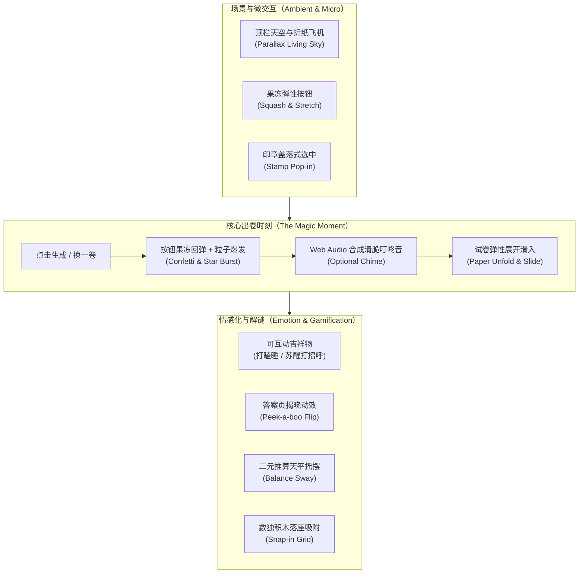

# 快乐数学练习屋 · 儿童趣味动画与 UI 交互提升改造计划

> **文档版本**：v1.0
> **制定日期**：2026-09-06
> **面向受众**：小学学龄儿童（数学启蒙至六年级，5~12 岁）及家长/教师
> **计划目标**：将当前偏成人控制台风格的界面，重塑为具备“即时弹性反馈、魔法出卷仪式感、角色陪伴与沉浸解谜趣味”的童趣数学工坊。

---

## 1. 改造背景与核心定位

### 1.1 现状诊断
当前项目具备极为出色的底层数学逻辑、严格的 A4 毫米级物理分页算法与打印隔离机制。但从儿童认知与交互心理学角度看，目前存在以下体验短板：
1. **反馈缺乏生命力（Not Juicy）**：点击按钮与切换选项仅有基础的变色或平移，缺乏儿童所喜爱的“如果冻、橡皮泥般”的物理弹性。
2. **生成时刻缺少仪式感（Anti-climactic）**：点击“✨ 生成练习题”后，仅有居中短促的文字字符闪烁（`.sparkles` 0.7s），随后画面直接生硬重绘，缺乏“变出试卷”的成就与期待感。
3. **角色缺乏互动（Static Mascot）**：空状态仅有一只固定角度机械摆动的小熊（`.empty .bear`），无法与小朋友产生眼神对视、点击打招呼或年级装束联动。
4. **纯视觉无多模态反馈**：做题与生成过程完全静音，缺乏轻量、治愈的听觉触感（如轻微的啵啵泡泡音、成功竖琴叮咚声）。

### 1.2 改造三大铁律（Engineering Principles）
为守护项目原有的高可用与高性能基线，所有改动必须严格遵守以下三条铁律：
- **铁律一：打印绝对隔离（Zero Print Intrusion）**
  所有新增动效层、粒子 Canvas、音频触发器与交互装饰必须在 `@media print` 下彻底静默（`display: none !important; animation: none !important;`），严禁侵入真实 A4 物理分页排版模型，不影响既有的 `pnpm test:layout` 和各题型 E2E 测试。
- **铁律二：零外部资源与超轻量（Zero External Assets）**
  不引入 Lottie、Framer Motion 等几百 KB 的重型外部动画库；音效必须采用浏览器原生 **Web Audio API** 纯代码合成正弦波/方波，**不使用任何外部 MP3/WAV 文件**，确保项目保持“无外链、离线可用、纯前端”的纯粹特性。
- **铁律三：性能与无障碍（Performance & Accessibility）**
  动画优先使用 GPU 合成层属性（`transform`、`opacity`），不触发重排（Reflow）；完整适配 `@media (prefers-reduced-motion: reduce)`，系统开启减弱动画时平滑降级。

---

## 2. 总体交互架构与动效矩阵



---

## 3. 具体功能设计与实现规范

### 3.1 核心体验：魔法出卷仪式感（The Magic Moment）
* **3.1.1 纯代码轻量 Canvas 五彩纸屑/星星粒子（`ConfettiBurst`）**
  - **位置**：点击“✨ 生成练习题”、“🎲 换一卷”或移动端悬浮生成条时。
  - **效果**：以鼠标/手指点击的坐标为圆心，向四周抛物线喷洒 24~36 颗轻量彩色粒子（包含金色五角星、马卡龙色彩纸屑、`+` `−` `×` `÷` 数学微符号），伴随重力下落和旋转，1.2 秒内自然淡出并销毁 Canvas 上下文。
  - **代码形态**：`src/shared/animation/confetti.ts`（约 80 行纯原生 Canvas 实现，不增加 npm 依赖）。
* **3.1.2 纸张展开与弹性滑入（`PaperReveal`）**
  - **位置**：预览区的 `.paper-stack`。
  - **效果**：生成成功后，纸张带有从轻微缩放与下沉过渡到正常尺寸的弹性阻尼动画：
    ```css
    @keyframes paper-reveal {
      0% { opacity: 0; transform: translateY(22px) scale(0.97); }
      70% { transform: translateY(-4px) scale(1.005); }
      100% { opacity: 1; transform: translateY(0) scale(1); }
    }
    ```
* **3.1.3 Web Audio 纯代码合成治愈音效引擎（`SoundSynthesizer`）**
  - **设计**：利用浏览器的 `AudioContext` 实时生成轻柔的正弦波频率跳跃：
    - **生成成功**：三音阶上升清脆竖琴音（C5 ➔ E5 ➔ G5 ➔ C6），伴随柔和指数衰减。
    - **按钮点击**：极短（30ms）的高频泡泡破裂音（Bubble Pop，800Hz ➔ 200Hz 快速滑音）。
  - **控件**：在顶部导航右侧增加一个可爱的小喇叭开关（`🔊 音效开 / 🔇 静音`），默认静音或轻量开启，状态持久化在 LocalStorage。

---

### 3.2 组件微交互：果冻弹簧与印章触感（Juicy Feedback）
* **3.2.1 按钮果冻弹性按压（Squash & Stretch）**
  - **样式规范**：
    ```css
    .choice-row button, .actions button {
      transition: transform 0.15s cubic-bezier(0.34, 1.56, 0.64, 1), box-shadow 0.15s ease;
    }
    .choice-row button:active, .actions button:active {
      transform: scale(0.93) translateY(2px);
    }
    ```
* **3.2.2 选项选中态的“印章盖落”（Stamp Pop-in）**
  - **设计**：年级（启蒙~六年级）、题量、知识点勾选框被选中时，选中的角标与背景色带有类似被木质印章“盖”在纸上的微震动与缩放弹出反馈（`scale(1.18) ➔ scale(1.0)`）。
* **3.2.3 题量步进器趣味微动效**
  - 自定义题量输入框聚焦时，外边框伴随柔和的马卡龙暖色光晕呼吸动效（Glow Pulse）。

---

### 3.3 情感化设计：互动伙伴与鼓励弹幕（Mascot & Mascot Expressions）
* **3.3.1 空状态小动物苏醒互动**
  - **初始状态**：小熊头顶冒出微小的 `z Z Z` 浮动符号，处于打瞌睡状态。
  - **悬停/轻触**：小熊睁大双眼、晃晃脑袋弹跳一下，头顶冒出 `💡` 或 `✨`，提示语动态展示：“*今天想挑战口算还是数独呢？*”
* **3.3.2 生成完成后的鼓励气泡（Cheer Pill）**
  - 生成新试卷时，在预览区右上角动态滑出一条胶囊鼓励语（1.5s 后自动淡出）：
    - *“思维小宇宙爆发啦 🚀”*
    - *“新练习纸热乎出炉 📄✨”*
    - *“向数学小博士进阶！🎓”*

---

### 3.4 三大模式专属解谜动效
* **3.4.1 二元推算：天平摇摆与符号吸附（Balance & Snap）**
  - **天平平衡感**：题目卡片载入时，等式两端产生极其微幅的上下错落摇晃（模拟天平两端放上砝码后的找平过程），在 0.5 秒内归平，直观强化“等式两边完全相等”的代数直觉。
  - **符号光泽（Shimmer）**：鼠标滑过图形（🦊、🍎、⭐、🚗）时，图形轻微放大跳动一下（`translateY(-2px) scale(1.08)`）。
* **3.4.2 数独模式：积木卡扣落座（Snap-in Grid）**
  - 数独生成时，4×4 / 9×9 初始提示数字以 30ms 的极短级联延迟从轻微凸起嵌入网格，如同把乐高积木按入底盘。
* **3.4.3 答案页：揭晓盲盒式翻转（Peek-a-boo Reveal）**
  - 点击“💡 显示答案页”时，答案容器带有 3D 微透视翻转或百叶窗式自上而下顺滑舒展效果，让核对答案变成“揭开谜底”的愉悦过程。

---

### 3.5 场景氛围：天空环境与打卡激励
* **3.5.1 动态微风天空与折纸飞机（Living Sky）**
  - 顶部天空（`.sky-decor`）增加一架精致的 SVG 折纸小飞机，每隔 45 秒悠闲地划过一道微弧线飞向右上方，呼应“纸质打印”与“童年飞翔”。
* **3.5.2 坚持打卡天数星星点亮（Streak Star Ignition）**
  - 在选项中勾选“打卡天数”时，界面上掠过 3 颗小金星依次点亮的微闪烁（Twinkle Sequence），强化每日坚持的成就感。

---

## 4. 文件与代码结构改动清单

```text
src/
├── shared/
│   ├── animation/
│   │   ├── confetti.ts          # [新增] 纯原生 Canvas 粒子喷射（零依赖，约 80 行）
│   │   └── keyframes.css        # [新增/整合] 童趣弹性曲线与通用动效定义
│   ├── audio/
│   │   └── sound-synth.ts       # [新增] 原生 Web Audio 纯代码合成引擎（泡泡音、叮咚音、静音开关）
│   └── ui/
│       ├── SoundToggle.tsx      # [新增] 顶栏音效静音切换小控件
│       └── MascotFriend.tsx     # [新增/升级] 可交互空状态伙伴组件
├── styles.css                   # [修改] 注入果冻按钮、印章动效、纸张进场、强制 print 隔离保护
├── features/
│   ├── worksheet-builder/
│   │   └── MathWorksheetBuilder.tsx # [修改] 接入粒子爆发、纸张展开、音效与鼓励语
│   ├── sudoku/
│   │   ├── SudokuStudio.tsx         # [修改] 接入生成动效与积木格子落座
│   │   └── sudoku.css               # [修改] 数独专属交互样式
│   └── binary-reasoning/
│       ├── BinaryReasoningStudio.tsx# [修改] 接入天平微动效与符号交互
│       └── binary-reasoning.css     # [修改] 二元推算专属动效
```

---

## 5. 分期落地实施路线图

| 阶段 | 周期/优先级 | 核心交付内容 | 预期体验收益 |
| :--- | :--- | :--- | :--- |
| **Phase 1** | **P0（立竿见影）** | 1. 按钮果冻弹性按压与印章选中态 CSS<br/>2. 纯代码 Canvas 粒子喷射（`ConfettiBurst`）<br/>3. 试卷生成时纸张弹性展开动画（`PaperReveal`） | 消除界面的呆板冷淡感，出卷瞬间具备强烈的“魔法获得感”。 |
| **Phase 2** | **P1（多模态升级）**| 1. Web Audio 原生合成轻量音效引擎（泡泡音/生成叮音）及静音按钮<br/>2. 空状态小动物交互（打瞌睡到苏醒打招呼）<br/>3. 答案页揭秘展开动效与随机鼓励胶囊气泡 | 听觉与视觉协同，带来类似儿童益智 App 的生动陪伴感。 |
| **Phase 3** | **P2（题型深度）** | 1. 二元推算天平摇摆与符号高光<br/>2. 数独棋盘积木落座嵌入感<br/>3. 顶栏折纸小飞机与打卡星星点亮动效 | 增强各模式的解谜游戏感与探索乐趣，提升长线打卡动力。 |

---

## 6. 质量保障与验收标准

1. **构建与测试全绿**：
   - 执行 `pnpm build` 和 `pnpm lint` 零告警。
   - 执行 `pnpm test`（全部现有 259+ 单元测试）通过。
2. **A4 物理排版与打印回归（最高优先级）**：
   - 执行 `pnpm test:layout`、`pnpm test:sudoku-layout`、`pnpm test:binary-reasoning-layout` 保证百分之百通过。
   - 浏览器实际打印预览（Ctrl+P / 打印指令）确认：纸张无多余溢出白页、无任何动画残影或粒子留在页面上、文字位置与原本毫米排版完全一致。
3. **性能基线测试**：
   - 60 FPS 满帧运行，无长任务（Long Task > 50ms）。
   - 粒子执行期间不阻塞 React 状态更新，1.5 秒内自动清理 Canvas DOM 与内存，无内存泄漏。
4. **无障碍检查**：
   - 开启系统的“减弱动态效果（Reduce Motion）”时，所有果冻弹性与粒子自动静默，平稳降级为瞬时切换。
